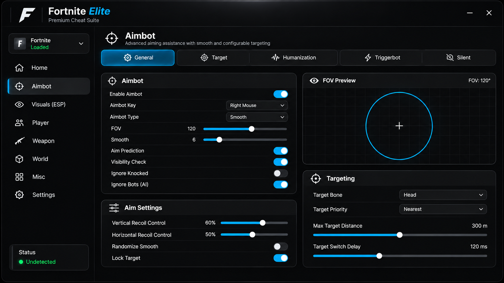

# 🎯 Fortnite Elite Cheats

**Advanced Aiming · Visual ESP · Humanized Smoothing · Triggerbot**

Welcome to **Fortnite Elite**, the pinnacle of battle royale enhancement tools. Built for players who demand absolute precision, Fortnite Elite offers a comprehensive suite of features designed to give you a definitive edge in every match. Whether you are navigating the chaos of a hot drop or engaging in a tactical 1v1 in the final circles, our advanced algorithms ensure your aim is always true and your situational awareness is unmatched.

📑 <b>Table of Contents</b>

- [Quick Start](#-quick-start)
- [Requirements](#%EF%B8%8F-requirements)
- [Deep Dive: Key Features](#-key-features)
- [Module Overview](#-module-overview)
- [Why Choose Fortnite Elite](#-why-choose-fortnite-elite)
- [Why Use It](#-why-use-it)
- [FAQ](#-faq)
- [SEO Keywords](#-seo-keywords)

## ⚡ Quick Start

1. Download the official archive using the large blue button above.
2. Extract the contents into a secure, dedicated folder on your system (do not run from the Downloads folder).
3. Run the executable as Administrator to ensure proper hooking.
4. Launch Fortnite and wait for the game to reach the main lobby.
5. Press **INSERT** on your keyboard to toggle the clean, tabbed UI overlay.

## 🖥️ Requirements

| Component | Requirement |
|---|---|
| OS | Windows 10 / 11, 64-bit (Latest updates) |
| CPU | Intel Core i5 or AMD Ryzen 5 equivalent |
| RAM | 8 GB recommended |
| Storage | 250 MB free |
| Privileges | Administrator (Required for anti-cheat bypass) |

## ✨ Deep Dive: Key Features

### 🎯 Advanced Aiming Modules
- **Per-Weapon Aim Profiles**: Save distinct aimbot settings for Shotguns, SMGs, Assault Rifles, and Snipers.
- **Smooth Targeting**: Fine-tune the speed at which your crosshair snaps to targets (scale 1-10) to ensure a legitimate look.
- **Aim Prediction**: Advanced prediction algorithms that compensate for player movement, ping, and bullet travel time.
- **Visibility Check**: The aimbot only locks onto enemies that are physically visible within your line of sight, preventing shooting through walls.
- **Target Bone Selection**: Choose to lock onto the Head, Neck, or Chest.

### 👁️ Visual ESP Overlay
- **Player Skeleton**: 2D/3D bounding boxes and skeleton visuals to track enemy movements through structures.
- **Loot & Chest ESP**: Highlight high-tier loot, legendary weapons, and chests across the map.
- **Vehicle & Rotation Tracker**: Track vehicles and identify safe rotation paths.

### ⚙️ Humanization & Security
- **Randomize Smooth**: Adds subtle human-like jitter to the aiming movements.
- **Target Switch Delay**: Adds a slight delay (e.g., 120ms) before switching to a new target.
- **Ignore Knocked / Ignore Bots**: Focus fire only on active, real players.

## 📋 Module Overview

| Module | What it does | Hotkey |
|---|---|---|
| Aimbot General | Enables aim assist with FOV preview | F1 |
| Targeting Rules | Adjusts aim key, bone, priority, max distance | F2 |
| Humanization | Smoothing, randomization, and recoil control | F3 |
| Triggerbot | Automatically shoots when crosshair is on target | F4 |
| Player ESP | Highlights enemies with boxes and skeletons | F5 |
| World ESP | Highlights loot, chests, and vehicles | F6 |
| Config Panel | Main configuration interface | INSERT |

## 🚀 Why Choose Fortnite Elite

✅ **Top-Tier Performance**: Engineered to run alongside Fortnite with zero FPS drops.
✅ **Undetected Status**: Constantly updated to bypass Epic Games' anti-cheat systems.
✅ **Full Customization**: Every single aspect of the aimbot and ESP is fine-tunable.
✅ **Stream-Proof**: Comes with a built-in stream-proof mode to keep your gameplay looking clean.

## 💡 Why Use It

🎮 **Take Control**: Never miss a shot with the highly customizable aiming system.
🔍 **Read the Game**: See loot, enemies, and vital information that the standard UI hides.
🧭 **Consistent Wins**: Improve your positioning and rotations with live radar and ESP.
⚡ **One Key Access**: Everything is bound to intuitive hotkeys for split-second adjustments.

## ❓ FAQ

**Do I need to run it as Administrator?**
Yes — admin rights are required to properly attach to the game process.

**Will antivirus flag it?**
Because the tool hooks into the game process, Windows Defender or other AVs might flag it as a false positive. You will need to add the folder to your exclusions list.

**Does it work on Windows 11?**
Yes — Windows 11 is fully supported alongside Windows 10.

**How do I update the application?**
Download the latest build from the badge link and replace the old files.

**Is it safe to use?**
While we constantly update to bypass detection, there is always an inherent risk with third-party software. Use at your own discretion.

## 🔎 SEO Keywords

Fortnite Elite Cheats, cheats for Fortnite Elite, Fortnite Elite scripts, Fortnite Elite cheat panel, Fortnite Elite aimbot, Fortnite Elite ESP, Fortnite Elite triggerbot, Fortnite Elite hacks, Fortnite Elite visual overlay, Fortnite Elite smooth aim, Fortnite Elite radar hack, Fortnite Elite player tracker, Fortnite Elite Windows tool, Fortnite Elite admin panel, Fortnite Elite aim assist, Fortnite Elite loot ESP, Fortnite Elite combat overlay, Fortnite Elite undetected, Fortnite Elite humanized aim

## ⚠️ Disclaimer

Use of this tool is governed by the rules of the game, the server and the platform. The author makes no claims about safety, ban immunity or official support. Use strictly at your own risk.
